# Reimagina built-form port

A Lyra plugin that calculates lot and block built-form and walking accessibility
indicators for a Reimagina scenario, read from its Postgres database and its
project's road network. Prepared GeoParquet snapshots and a synthetic example run
the same metrics entirely offline.

Run the example with `uv run python examples/local_snapshot.py`.

See [usage and snapshot format](docs/usage.md), [design and provenance](docs/design.md),
[verification](docs/verification.md), and [deployment](docs/deployment.md).

# Diagram

```mermaid
flowchart LR
    n0["<b>Metric: reimagina_accessibility</b><br/><br/><b>Inputs</b><br/>#8226;#160;blocks:#160;reimagina_built_form#46;reimagina_built_form_blocks<br/>#8226;#160;edges:#160;reimagina_road_network#46;reimagina_road_network_edges<br/>#8226;#160;lots:#160;reimagina_built_form#46;reimagina_built_form_lots<br/>#8226;#160;nodes:#160;reimagina_road_network#46;reimagina_road_network_nodes<br/>#8226;#160;pois:#160;reimagina_scenario_pois#46;reimagina_scenario_pois<br/><br/><b>Output: reimagina_accessibility_blocks</b><br/>#8226;#160;id:#160;string<br/>#8226;#160;parent_id:#160;string<br/>#8226;#160;source_record_ref:#160;string<br/>#8226;#160;minutes:#160;number<br/>#8226;#160;farthest_amenity:#160;string<br/>#8226;#160;accessibility_park:#160;#91;score#93;<br/>#8226;#160;accessibility_daycare:#160;#91;score#93;<br/>#8226;#160;accessibility_preschool:#160;#91;score#93;<br/>#8226;#160;accessibility_primary_school:#160;#91;score#93;<br/>#8226;#160;accessibility_secondary_school:#160;#91;score#93;<br/>#8226;#160;accessibility_high_school:#160;#91;score#93;<br/>#8226;#160;accessibility_university:#160;#91;score#93;<br/>#8226;#160;accessibility_hospital:#160;#91;score#93;<br/>#8226;#160;accessibility_clinic:#160;#91;score#93;<br/>#8226;#160;accessibility_pharmacy:#160;#91;score#93;<br/>#8226;#160;accessibility_cinema:#160;#91;score#93;<br/>#8226;#160;accessibility_gym:#160;#91;score#93;<br/>#8226;#160;accessibility_recreation:#160;#91;score#93;<br/>#8226;#160;distance_to_park:#160;number<br/>#8226;#160;distance_to_daycare:#160;number<br/>#8226;#160;distance_to_preschool:#160;number<br/>#8226;#160;distance_to_primary_school:#160;number<br/>#8226;#160;distance_to_secondary_school:#160;number<br/>#8226;#160;distance_to_high_school:#160;number<br/>#8226;#160;distance_to_university:#160;number<br/>#8226;#160;distance_to_hospital:#160;number<br/>#8226;#160;distance_to_clinic:#160;number<br/>#8226;#160;distance_to_pharmacy:#160;number<br/>#8226;#160;distance_to_cinema:#160;number<br/>#8226;#160;distance_to_gym:#160;number<br/>#8226;#160;distance_to_recreation:#160;number<br/>#8226;#160;Geometry:#160;geometry<br/><br/><b>Output: reimagina_accessibility_lots</b><br/>#8226;#160;id:#160;string<br/>#8226;#160;parent_id:#160;string<br/>#8226;#160;source_record_ref:#160;string<br/>#8226;#160;minutes:#160;number<br/>#8226;#160;farthest_amenity:#160;string<br/>#8226;#160;accessibility_park:#160;#91;score#93;<br/>#8226;#160;accessibility_daycare:#160;#91;score#93;<br/>#8226;#160;accessibility_preschool:#160;#91;score#93;<br/>#8226;#160;accessibility_primary_school:#160;#91;score#93;<br/>#8226;#160;accessibility_secondary_school:#160;#91;score#93;<br/>#8226;#160;accessibility_high_school:#160;#91;score#93;<br/>#8226;#160;accessibility_university:#160;#91;score#93;<br/>#8226;#160;accessibility_hospital:#160;#91;score#93;<br/>#8226;#160;accessibility_clinic:#160;#91;score#93;<br/>#8226;#160;accessibility_pharmacy:#160;#91;score#93;<br/>#8226;#160;accessibility_cinema:#160;#91;score#93;<br/>#8226;#160;accessibility_gym:#160;#91;score#93;<br/>#8226;#160;accessibility_recreation:#160;#91;score#93;<br/>#8226;#160;distance_to_park:#160;number<br/>#8226;#160;distance_to_daycare:#160;number<br/>#8226;#160;distance_to_preschool:#160;number<br/>#8226;#160;distance_to_primary_school:#160;number<br/>#8226;#160;distance_to_secondary_school:#160;number<br/>#8226;#160;distance_to_high_school:#160;number<br/>#8226;#160;distance_to_university:#160;number<br/>#8226;#160;distance_to_hospital:#160;number<br/>#8226;#160;distance_to_clinic:#160;number<br/>#8226;#160;distance_to_pharmacy:#160;number<br/>#8226;#160;distance_to_cinema:#160;number<br/>#8226;#160;distance_to_gym:#160;number<br/>#8226;#160;distance_to_recreation:#160;number<br/>#8226;#160;Geometry:#160;geometry"]
    n1["<b>Dataset: reimagina_baseline</b><br/><br/><b>Output: reimagina_baseline_blocks</b><br/>#8226;#160;id:#160;string<br/>#8226;#160;parent_id:#160;string<br/>#8226;#160;source_record_ref:#160;string<br/>#8226;#160;vivtot:#160;#91;count#93;<br/>#8226;#160;people_per_household:#160;#91;count#93;<br/>#8226;#160;Geometry:#160;geometry<br/><b>Output: reimagina_baseline_lots</b><br/>#8226;#160;id:#160;string<br/>#8226;#160;parent_id:#160;string<br/>#8226;#160;source_record_ref:#160;string<br/>#8226;#160;land_use:#160;string<br/>#8226;#160;cos:#160;#91;ratio#93;<br/>#8226;#160;num_levels:#160;#91;count#93;<br/>#8226;#160;area:#160;#91;m2#93;<br/>#8226;#160;unit_size_m2:#160;#91;m2#93;<br/>#8226;#160;people_per_household:#160;#91;count#93;<br/>#8226;#160;occupancy_rate:#160;#91;ratio#93;<br/>#8226;#160;amenity_type:#160;string<br/>#8226;#160;commerce_type:#160;string<br/>#8226;#160;Geometry:#160;geometry"]
    n2["<b>Metric: reimagina_baseline_elements</b><br/><br/><b>Inputs</b><br/>#8226;#160;blocks:#160;reimagina_baseline#46;reimagina_baseline_blocks<br/>#8226;#160;lots:#160;reimagina_baseline#46;reimagina_baseline_lots<br/><br/><b>Output: reimagina_baseline_elements_blocks</b><br/>#8226;#160;id:#160;string<br/>#8226;#160;parent_id:#160;string<br/>#8226;#160;source_record_ref:#160;string<br/>#8226;#160;vivtot:#160;#91;count#93;<br/>#8226;#160;people_per_household:#160;#91;count#93;<br/>#8226;#160;Geometry:#160;geometry<br/><br/><b>Output: reimagina_baseline_elements_lots</b><br/>#8226;#160;id:#160;string<br/>#8226;#160;parent_id:#160;string<br/>#8226;#160;source_record_ref:#160;string<br/>#8226;#160;land_use:#160;string<br/>#8226;#160;cos:#160;#91;ratio#93;<br/>#8226;#160;num_levels:#160;#91;count#93;<br/>#8226;#160;area:#160;#91;m2#93;<br/>#8226;#160;unit_size_m2:#160;#91;m2#93;<br/>#8226;#160;people_per_household:#160;#91;count#93;<br/>#8226;#160;occupancy_rate:#160;#91;ratio#93;<br/>#8226;#160;amenity_type:#160;string<br/>#8226;#160;commerce_type:#160;string<br/>#8226;#160;Geometry:#160;geometry"]
    n3["<b>Metric: reimagina_baseline_write</b><br/><br/><b>Inputs</b><br/>#8226;#160;blocks:#160;reimagina_baseline#46;reimagina_baseline_blocks<br/>#8226;#160;lots:#160;reimagina_baseline#46;reimagina_baseline_lots<br/><br/><b>Output: reimagina_baseline_write</b><br/>#8226;#160;elements:#160;#91;count#93;<br/>#8226;#160;elements_created:#160;#91;count#93;<br/>#8226;#160;attribute_values:#160;#91;count#93;<br/>#8226;#160;elements_removed:#160;#91;count#93;<br/>#8226;#160;dry_run:#160;boolean"]
    n4["<b>Metric: reimagina_built_form</b><br/><br/><b>Inputs</b><br/>#8226;#160;blocks:#160;reimagina_scenario#46;reimagina_scenario_blocks<br/>#8226;#160;lots:#160;reimagina_lot_built_form#46;reimagina_lot_indicators<br/><br/><b>Output: reimagina_built_form_blocks</b><br/>#8226;#160;id:#160;string<br/>#8226;#160;parent_id:#160;string<br/>#8226;#160;source_record_ref:#160;string<br/>#8226;#160;cos:#160;#91;ratio#93;<br/>#8226;#160;num_levels:#160;#91;count#93;<br/>#8226;#160;cus:#160;#91;ratio#93;<br/>#8226;#160;area:#160;#91;m2#93;<br/>#8226;#160;unit_size_m2:#160;#91;m2#93;<br/>#8226;#160;num_housing_units:#160;#91;count#93;<br/>#8226;#160;population:#160;#91;count#93;<br/>#8226;#160;density:#160;number<br/>#8226;#160;Geometry:#160;geometry<br/><br/><b>Output: reimagina_built_form_lots</b><br/>#8226;#160;id:#160;string<br/>#8226;#160;parent_id:#160;string<br/>#8226;#160;source_record_ref:#160;string<br/>#8226;#160;cos:#160;#91;ratio#93;<br/>#8226;#160;num_levels:#160;#91;count#93;<br/>#8226;#160;cus:#160;#91;ratio#93;<br/>#8226;#160;area:#160;#91;m2#93;<br/>#8226;#160;unit_size_m2:#160;#91;m2#93;<br/>#8226;#160;num_housing_units:#160;#91;count#93;<br/>#8226;#160;population:#160;#91;count#93;<br/>#8226;#160;density:#160;number<br/>#8226;#160;Geometry:#160;geometry"]
    n5["<b>Metric: reimagina_lot_built_form</b><br/><br/><b>Inputs</b><br/>#8226;#160;lots:#160;reimagina_scenario#46;reimagina_scenario_lots<br/><br/><b>Output: reimagina_lot_indicators</b><br/>#8226;#160;id:#160;string<br/>#8226;#160;parent_id:#160;string<br/>#8226;#160;source_record_ref:#160;string<br/>#8226;#160;cos:#160;#91;ratio#93;<br/>#8226;#160;num_levels:#160;#91;count#93;<br/>#8226;#160;cus:#160;#91;ratio#93;<br/>#8226;#160;area:#160;#91;m2#93;<br/>#8226;#160;unit_size_m2:#160;#91;m2#93;<br/>#8226;#160;num_housing_units:#160;#91;count#93;<br/>#8226;#160;population:#160;#91;count#93;<br/>#8226;#160;density:#160;number<br/>#8226;#160;Geometry:#160;geometry"]
    n6["<b>Dataset: reimagina_road_network</b><br/><br/><b>Output: reimagina_road_network_edges</b><br/>#8226;#160;from:#160;integer<br/>#8226;#160;to:#160;integer<br/>#8226;#160;distance:#160;#91;m#93;<br/>#8226;#160;two_way:#160;boolean<br/><b>Output: reimagina_road_network_nodes</b><br/>#8226;#160;id:#160;integer<br/>#8226;#160;x:#160;number<br/>#8226;#160;y:#160;number"]
    n7["<b>Dataset: reimagina_scenario</b><br/><br/><b>Output: reimagina_scenario_blocks</b><br/>#8226;#160;id:#160;string<br/>#8226;#160;parent_id:#160;string<br/>#8226;#160;source_record_ref:#160;string<br/>#8226;#160;Geometry:#160;geometry<br/><b>Output: reimagina_scenario_lots</b><br/>#8226;#160;id:#160;string<br/>#8226;#160;parent_id:#160;string<br/>#8226;#160;source_record_ref:#160;string<br/>#8226;#160;cos:#160;#91;ratio#93;<br/>#8226;#160;num_levels:#160;#91;count#93;<br/>#8226;#160;area:#160;#91;m2#93;<br/>#8226;#160;land_use:#160;string<br/>#8226;#160;unit_size_m2:#160;#91;m2#93;<br/>#8226;#160;people_per_household:#160;#91;count#93;<br/>#8226;#160;occupancy_rate:#160;#91;ratio#93;<br/>#8226;#160;Geometry:#160;geometry"]
    n8["<b>Metric: reimagina_scenario_accessibility</b><br/><br/><b>Inputs</b><br/>#8226;#160;blocks:#160;reimagina_accessibility#46;reimagina_accessibility_blocks<br/>#8226;#160;lots:#160;reimagina_accessibility#46;reimagina_accessibility_lots<br/><br/><b>Output: reimagina_scenario_accessibility</b><br/>#8226;#160;elements:#160;#91;count#93;<br/>#8226;#160;values_written:#160;#91;count#93;<br/>#8226;#160;values_cleared:#160;#91;count#93;<br/>#8226;#160;dry_run:#160;boolean"]
    n9["<b>Metric: reimagina_scenario_indicators</b><br/><br/><b>Inputs</b><br/>#8226;#160;blocks:#160;reimagina_built_form#46;reimagina_built_form_blocks<br/>#8226;#160;lots:#160;reimagina_built_form#46;reimagina_built_form_lots<br/><br/><b>Output: reimagina_scenario_indicators</b><br/>#8226;#160;elements:#160;#91;count#93;<br/>#8226;#160;values_written:#160;#91;count#93;<br/>#8226;#160;values_cleared:#160;#91;count#93;<br/>#8226;#160;dry_run:#160;boolean"]
    n10["<b>Dataset: reimagina_scenario_pois</b><br/><br/><b>Output: reimagina_scenario_pois</b><br/>#8226;#160;id:#160;string<br/>#8226;#160;amenity_type:#160;string<br/>#8226;#160;capacity:#160;#91;count#93;<br/>#8226;#160;Geometry:#160;geometry"]
    n11["<b>Metric: reimagina_scenario_write</b><br/><br/><b>Inputs</b><br/>#8226;#160;accessibility:#160;reimagina_scenario_accessibility#46;reimagina_scenario_accessibility<br/>#8226;#160;indicators:#160;reimagina_scenario_indicators#46;reimagina_scenario_indicators<br/><br/><b>Output: reimagina_scenario_write</b><br/>#8226;#160;elements:#160;#91;count#93;<br/>#8226;#160;values_written:#160;#91;count#93;<br/>#8226;#160;values_cleared:#160;#91;count#93;<br/>#8226;#160;dry_run:#160;boolean"]
    n4 -->|"reimagina_built_form_blocks #8594; blocks"| n0
    n6 -->|"reimagina_road_network_edges #8594; edges"| n0
    n4 -->|"reimagina_built_form_lots #8594; lots"| n0
    n6 -->|"reimagina_road_network_nodes #8594; nodes"| n0
    n10 -->|"reimagina_scenario_pois #8594; pois"| n0
    n1 -->|"reimagina_baseline_blocks #8594; blocks"| n2
    n1 -->|"reimagina_baseline_lots #8594; lots"| n2
    n1 -->|"reimagina_baseline_blocks #8594; blocks"| n3
    n1 -->|"reimagina_baseline_lots #8594; lots"| n3
    n7 -->|"reimagina_scenario_blocks #8594; blocks"| n4
    n5 -->|"reimagina_lot_indicators #8594; lots"| n4
    n7 -->|"reimagina_scenario_lots #8594; lots"| n5
    n0 -->|"reimagina_accessibility_blocks #8594; blocks"| n8
    n0 -->|"reimagina_accessibility_lots #8594; lots"| n8
    n4 -->|"reimagina_built_form_blocks #8594; blocks"| n9
    n4 -->|"reimagina_built_form_lots #8594; lots"| n9
    n8 -->|"reimagina_scenario_accessibility #8594; accessibility"| n11
    n9 -->|"reimagina_scenario_indicators #8594; indicators"| n11
```

