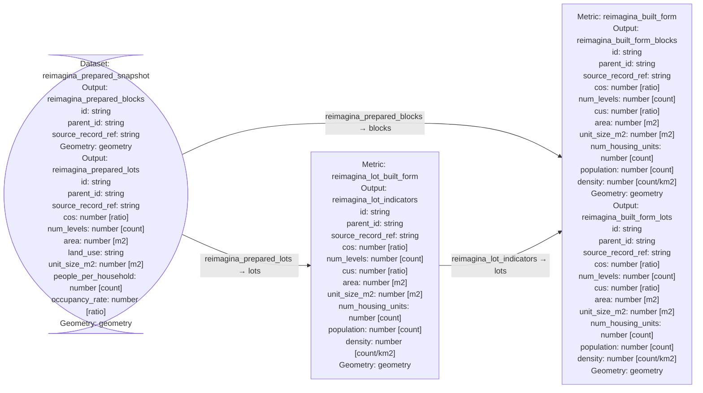

# Reimagina built-form port

A Lyra plugin that calculates lot and block built-form indicators from prepared
GeoParquet snapshots. Includes a synthetic example that runs entirely offline.

Run the example with `uv run python examples/local_snapshot.py`.

See [usage and snapshot format](docs/usage.md), [design and provenance](docs/design.md),
and [verification](docs/verification.md).

# Diagram

