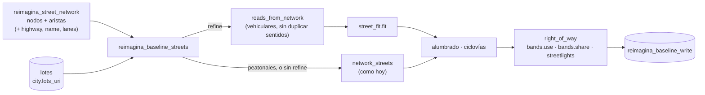

# Plan: afinado de los `right_of_way` (`street_fit`) en `port-afinado`

Traer de `port-other-indicators-with-lab` el paso que ajusta las calles a los lotes
(`ingestion/street_fit.py`) **sin cambiar el pipeline ni los atributos de esta branch**. La red de
calles, el H5 de pandana, los nodos de Lyra, el writer y los indicadores siguen igual; lo único nuevo es
un paso opcional dentro de `reimagina_baseline_streets` que cambia *qué líneas* son `right_of_way` y
*qué bandas* llevan.

Las rutas son relativas a `src/reimagina_test_port/` salvo que se diga otra cosa.

## Qué cambia y qué no

| | Hoy | Con `fit` |
|---|---|---|
| Red de calles (`reimagina_street_network`) | OSM `walk` + `custom_filter`, merge opcional | Igual, y las aristas conservan `highway`, `name`, `lanes` de OSM |
| H5 de pandana / `road_network_uri` | Desde nodos y aristas | **Sin cambio** (el nombre del H5 no depende de las columnas nuevas) |
| Un `right_of_way` es… | Una arista (par de nodos `lo-hi`) | Vehiculares: un tramo de intersección a intersección, avenida con camellón = uno. Peatonales: igual que hoy |
| Geometría | Forma de la vía de OSM | Vehiculares: eje centrado entre los frentes de lote |
| Atributos | `bands.use`, `bands.share`, `streetlights` | **Los mismos tres** |
| `bands.use` / `bands.share` | Perfil fijo (20/60/20, 20/10/50/20) | Vehiculares: bandas del ancho medido (banqueta · carriles · [camellón · carriles] · banqueta), con la ciclovía insertada en su lado |
| `streetlights` | Caras a ≤ 25 m | Vehiculares: caras a ≤ `max(25, ancho/2 + 5)` |
| Ciclovía | Punto medio a ≤ 15 m | Vehiculares: ≥ 50 % del eje a ≤ `max(15, ancho/2)`, del lado de la ciclovía |
| Activación | — | `refine: true` en el YAML de la ciudad; apagado por defecto |

Con `refine: false` (o sin la llave) la salida debe ser **idéntica** a la de hoy; los tests actuales
lo comprueban.

## Flujo

---

## Pasos

### 1. Conservar los atributos de OSM en la red (`ingestion/network.py`, `ingestion/nodes.py`)

`street_fit` necesita la clase vial (`highway`), el nombre y los carriles de cada arista. Hoy
`osm_tables` los descarta.

- `osm_tables`: agregar `highway`, `name` y `lanes` a las aristas. osmnx los entrega como lista cuando
  simplifica varias vías en una arista: tomar el primero (`_first` de la branch lab) y guardarlos como
  texto (`lanes` se parsea después).
- Caché de OSM (`osm_cache_uris`, `read_osm_cache`, `write_osm_cache`): las columnas nuevas viajan en el
  parquet de aristas. Agregar una versión al hash (p. ej. `b"v2"`) para que los cachés viejos, que no
  las tienen, no se lean.
- `merge_streets`: las aristas de las calles nuevas no traen `highway`. Opciones (decidir, ver
  *Decisiones*): dejarlo nulo y que `roads_from_network` lo trate como `residential`, o leer una
  columna `highway` del archivo de calles si existe. Las aristas que `_split` parte heredan las
  columnas de la arista original; los conectores de `bridge_pieces` quedan nulos.
- `street_network` (nodes.py): pasar las tres columnas a `reimagina_street_network_edges` y
  agregarlas a `STREET_EDGES_DECLARATION`.
- `save_h5` y `h5_name` no cambian: el H5 y su nombre siguen dependiendo solo de `from`, `to`,
  `length`.

### 2. Copiar `street_fit.py` (`ingestion/street_fit.py`)

Tal cual desde `port-other-indicators-with-lab` (commit `3eb43b9`). Solo depende de
geopandas/shapely/numpy/pandas. Su docstring ya dice que el código vive aquí y no sigue al lab.

### 3. Adaptador red → `roads` (`ingestion/streets.py`)

Nueva `roads_from_network(nodes, edges, crs) -> GeoDataFrame` con `street_fit.ROAD_COLUMNS`
(`road_key`, `from_node`, `to_node`, `road_type`, `name`, `lanes`, `lanes_tagged`, `lane_width_m`):

- **Una fila por par de nodos.** La red `walk` tiene cada vía en los dos sentidos (`u→v` y `v→u`,
  geometría invertida). Deduplicar igual que `network_streets` (`lo`, `hi`) antes de `fit`; si no,
  `fit` ve calles dobles.
- `road_key = "<lo>-<hi>"`, la misma llave que hoy.
- Orientar: `from_node` es el nodo en el que empieza la geometría (como `roads_of` en la branch lab).
- `road_type = ROAD_CLASS_BY_HIGHWAY[highway]`; `lanes` de OSM si es número, si no
  `DEFAULT_LANES[clase]` (`lanes_tagged` dice cuál); `lane_width_m = LANE_WIDTH_M[clase]`.
- **Solo vehiculares** entran a `fit` (clases distintas de `pedestrian`; ver *Decisiones* para
  `service`). El resto sigue el camino de hoy.

### 4. `build` con dos caminos (`ingestion/streets.py`)

`build(city, nodes, edges, workdir)` mantiene su firma y su salida (mismas columnas, EPSG:4326).

- Sin `refine`: exactamente el código actual.
- Con `refine`:
  1. `roads = roads_from_network(...)`; `lots = lot_shapes(city, workdir)` (lotes del catastro,
     `lake.download_shapefile(city.lots_uri, ...)`, válidos, en `city.target_crs`; la función ya existe
     en la branch lab).
  2. `fitted = street_fit.fit(roads, lots, city.streets.fit)`.
  3. Las aristas no vehiculares: `network_streets` como hoy, solo sobre esas aristas.
  4. Alumbrado: `streetlights` acepta `widths` opcional (alcance `max(max_distance_m, ancho/2 +
     front_tolerance_m)`); los peatonales pasan sin ancho.
  5. Ciclovías: `refined_lane_bands` + `side_of` + `with_bike_lane` para los afinados (copiados de la
     branch lab); `lane_bands` + `PROFILES` para los peatonales.
  6. Concatenar ambos y salir con las mismas tres columnas de atributos. `width_m`, `lanes`, etc. se
     usan dentro de `build` y no se escriben (ver *Decisiones*).
- Llave e id: `source_record_ref = fitted["key"]` (la menor `lo-hi` de sus aristas, `#n` si se
  repite), `id = stable_element_uuid(city.key, "right_of_way", key)`, como hoy. Las llaves afinadas
  y las peatonales no chocan porque salen de aristas distintas.
- `bands.use` puede traer `median`. Verificar que nada lo rechace (hoy `bands.use` es JSON sin enum;
  `lane_flags` solo busca `shared_lanes` / `protected_bike_lane`).

### 5. Configuración (`ingestion/cities/__init__.py`, `cities/mexicali.yaml`)

En lo que ya existe, sin mover secciones:

- `NetworkParams` (o un `StreetFit` propio dentro de `CityPreset`, según lo que sea más limpio en el
  parser): `refine: bool = False` y `fit: dict = {}` (parámetros sobre `street_fit.DEFAULTS`;
  una llave desconocida es error, como `_fit_params` en la branch lab).
- `StreetLighting.front_tolerance_m = 5.0`.
- `BikeLanes.min_share = 0.5` (en `(0, 1]`) y `BikeLanes.protected_width_m = 2.0` (> 0).
- `mexicali.yaml`: dejar `refine: false` al principio; prenderlo cuando se valide (paso 8).

Como `fit` vive en `reimagina_baseline_streets` y no en `reimagina_street_network`, cambiar
`refine` no cambia la red ni el H5.

### 6. Nodo de Lyra (`ingestion/nodes.py`)

- `reimagina_baseline_streets`: mismas entradas (`nodes`, `edges`) y misma salida
  (`RIGHT_OF_WAY_DECLARATION` sin columnas nuevas). Actualizar la descripción y el log (número de
  afinados, cuántos con los dos lados medidos).
- `BASELINE_ATTRIBUTES`, `catalogs.py`, `baseline_writer.py`: **sin cambios**.
- Regenerar `lyra.plugin.json` (las dos copias) por las columnas nuevas de
  `reimagina_street_network_edges` y las descripciones.

### 7. Tests (`tests/test_network.py`, `tests/test_baseline.py`)

Traer de la branch lab y adaptar a tablas de nodos/aristas sintéticas en lugar de parchear
`osm_roads`:

- `test_refined_streets`: una avenida con camellón da un solo `right_of_way`; las bandas suman 100;
  hay `median`.
- `test_refined_bike_lanes`, `test_refined_lane_bands`, `test_refined_lighting`: ciclovía en su lado,
  alcance del alumbrado con el ancho.
- `test_refined_keeps_pedestrian`: un `footway` sale como hoy (perfil fijo, su llave `lo-hi`).
- `test_roads_from_network_dedupes_directions`: `u→v` y `v→u` son una sola fila.
- `test_unrefined_streets_unchanged`: sin `refine`, salida igual a la actual.
- `test_refined_streets_in_the_yaml`: el parser lee `refine` / `fit` y rechaza llaves desconocidas.
- `test_network`: las aristas traen `highway`/`name`/`lanes`; un caché sin versión no se lee.
- **No** copiar el `tests/` que la branch lab agregó a `.gitignore`.

### 8. Validación con Mexicali

Antes de prender `refine` en el YAML:

- Correr `reimagina_baseline_streets` con y sin `refine` y comparar: número de `right_of_way`,
  longitud total, % con los dos lados medidos, distribución de anchos por clase, cobertura de
  ciclovía y alumbrado por manzana (`reimagina_streets`).
- Tiempo de `fit` sobre toda la ciudad (en la branch lab se probó en un recorte).
- Revisar en mapa avenidas con camellón, glorietas, calles en curva y la zona del merge si la hay.
- Opcional: traer `scripts/street_fit_metrics.py`, corrigiendo que usa el caché de `condesa` con los
  lotes de Mexicali.

### 9. Documentación

- `docs/design.md`, sección *Rights of way*: el paso de `fit`, qué clases afina, qué se queda como
  hoy.
- No traer `right_of_way_afinado_port.md` de la branch lab (describe la opción del archivo exportado,
  que no se tomó); `right_of_way_afinado_guia.md` y `_mejoras.md` pueden venir como referencia.

---

## Decisiones abiertas

| # | Pregunta | Propuesta |
|---|---|---|
| 1 | ¿`service` entra a `fit`? | Sí: es vehicular y la branch lab lo afinaba (red `drive`). Revisar en la validación si los estacionamientos ensucian |
| 2 | Calles del `merge_streets` sin `highway` | `residential` por defecto; leer `highway` del archivo si viene |
| 3 | ¿Se escriben `width_m`, `lanes`, `name`? | No por ahora (mantener los atributos de la branch). Agregarlos después es solo catálogo + declaración + `BASELINE_ATTRIBUTES` |
| 4 | Cambio de ids al prender `refine` | Los `right_of_way` vehiculares cambian de llave: es una migración del baseline (el writer borra los viejos y crea los nuevos). Hacerlo en un baseline nuevo o avisar si hay intervenciones sobre calles |
| 5 | `streetlights` por conteo de caras | Fuera de este plan; se arregla aparte (por longitud) para ambos caminos |

## Riesgos

- **Tiempo de corrida**: `fit` lanza rayos cada 3 m contra todos los lotes; en Mexicali completo
  puede ser largo. Medir en el paso 8.
- **Dos geometrías de calle**: el H5 sigue usando la red `walk` sin afinar; los `right_of_way`
  afinados no coinciden uno a uno con sus aristas. Ya pasaba (son redes distintas en propósito); no
  se resuelve aquí.
- **Lotes faltantes**: donde no hay catastro, los lados toman el ancho por defecto de su clase
  (`measured_sides < 2`); las bandas son estimadas.
